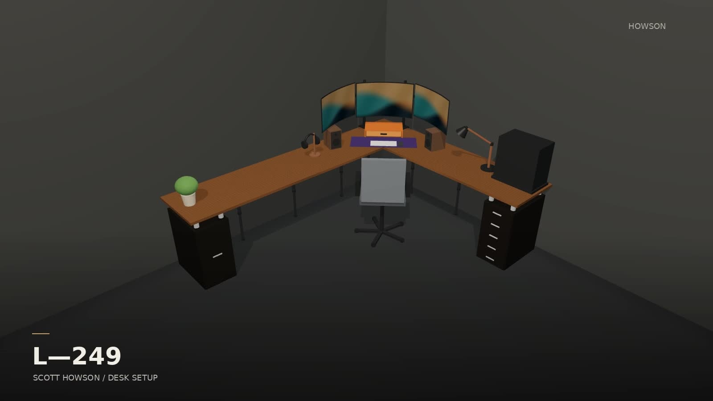

# desk-setup

L-shaped PC desk built from two IKEA EKBACKEN countertops (249 × 65 × 2.8 cm, brown walnut) on two ALEX units, six OLOV legs and two 2 × 2 × 3/16 in steel angle rails, with a VIVO STAND-V300CU triple monitor mount across the inside corner (Samsung Odyssey G5 32 in centre, two Acer XZ320QU 31.5 in curved sides, all landscape).

*30 s showcase film, 1920 × 1080: click the poster to play [`desk-showcase.mp4`](desk-showcase-source/desk-showcase.mp4). Rendered from the 3D model by [`desk-showcase-source/`](desk-showcase-source/README.md).*

`docs/build-manual.md` is the source of truth for every number; everything else is kept in step with it.

| What | Where |
| --- | --- |
| Build manual: every measurement in build order, with checklists | [`docs/build-manual.md`](docs/build-manual.md) |
| Print-ready build guide: the same numbers as dimensioned drawings and tables, one sheet per step | [`guide.html`](guide.html) |
| Design review: verified specs, load paths, bill of materials, drilling schedule, structural assessment, open measurements | [`docs/design-review.md`](docs/design-review.md) |
| Interactive 3D model (orbit, look under, toggle knee zone and labels) | [`index.html`](index.html), served by GitHub Pages at `https://scotthowson.github.io/desk-setup/` |
| Top-down plan | [`docs/plan.svg`](docs/plan.svg) |
| Showcase film (30 s, 1080p) and the renderer that makes it from the model | [`desk-showcase-source/desk-showcase.mp4`](desk-showcase-source/desk-showcase.mp4), [`desk-showcase-source/README.md`](desk-showcase-source/README.md) |
| Printed parts: marking tools, locating rings, cable parts, wall-gap trim, optional ALEX feet, with print list and cut list | [`parts/README.md`](parts/README.md) |

## Key numbers

- Top surface 83.0 cm (ALEX 70 + 4 in feet 10.16 + top 2.8); every OLOV set to 80.2 cm. Optional printed ALEX feet add 2, 4 or 6 cm to everything (table in the manual before step 5).
- Six OLOV legs along the two wall edges: L1 (15, 42), L2 (65, 10), L3 (140, 10), L4 (10, 85), L5 (10, 160), L6 (10, 235). Nothing stands in the knee corner.
- ALEX units centred under the wing ends with 3.5 cm of top showing all round; four 4 in feet per unit, pads in printed locating rings 5 cm in from each ALEX corner.
- Rails 12 cm back from the front edges, 213 cm each, joined at the inside corner by two 5 mm gusseted strut fittings on 3/8 bolts; under-rail clearance 75.1 cm.
- VIVO clamps centred at (40, 0) and (0, 40) on top A's two wall edges; crossbar measured 50.2 cm centre to centre, so the poles sit 50.2 cm apart on the diagonal.
- Tops stand 3 cm off both walls; printed trim covers the gap and locates the clamps.

Coordinates throughout are (x, y) in cm from the back-left corner of top A: x along the back wall, y along the side wall.
