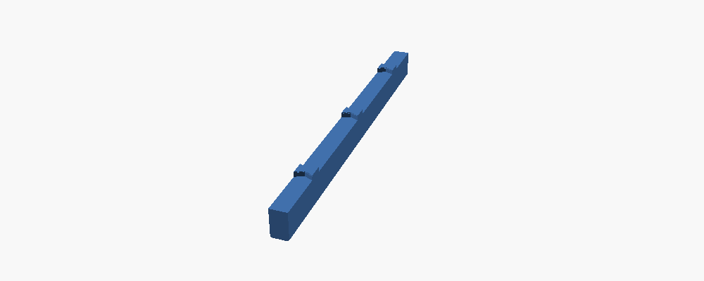
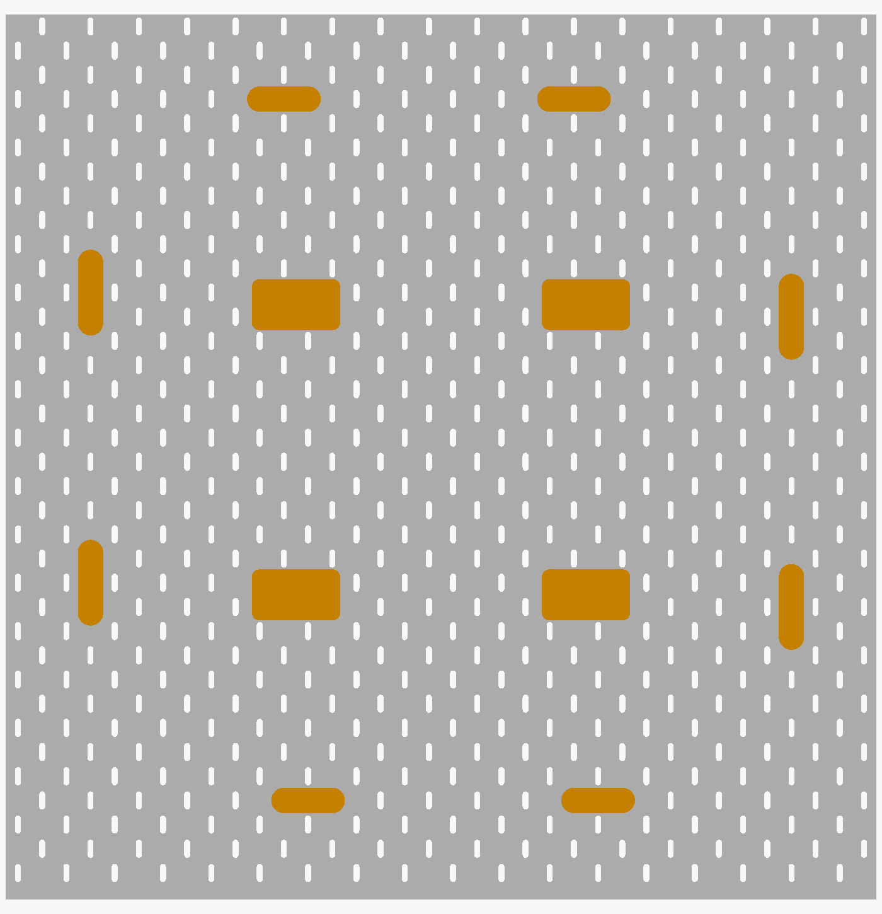
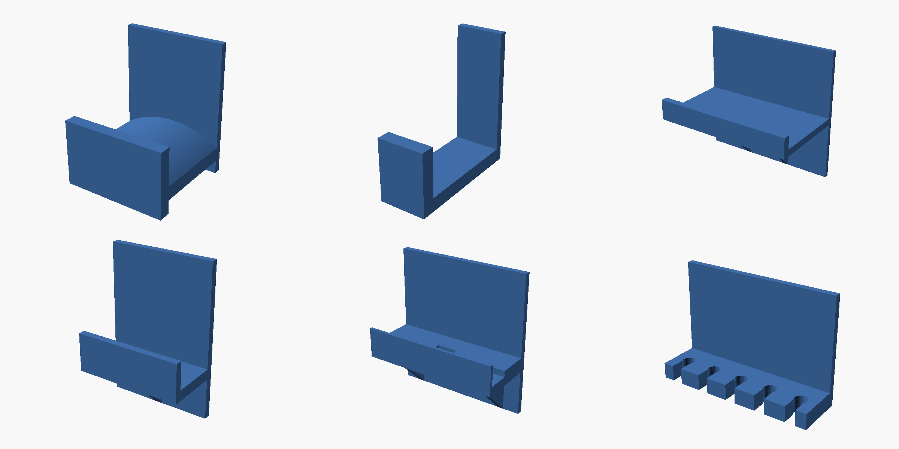
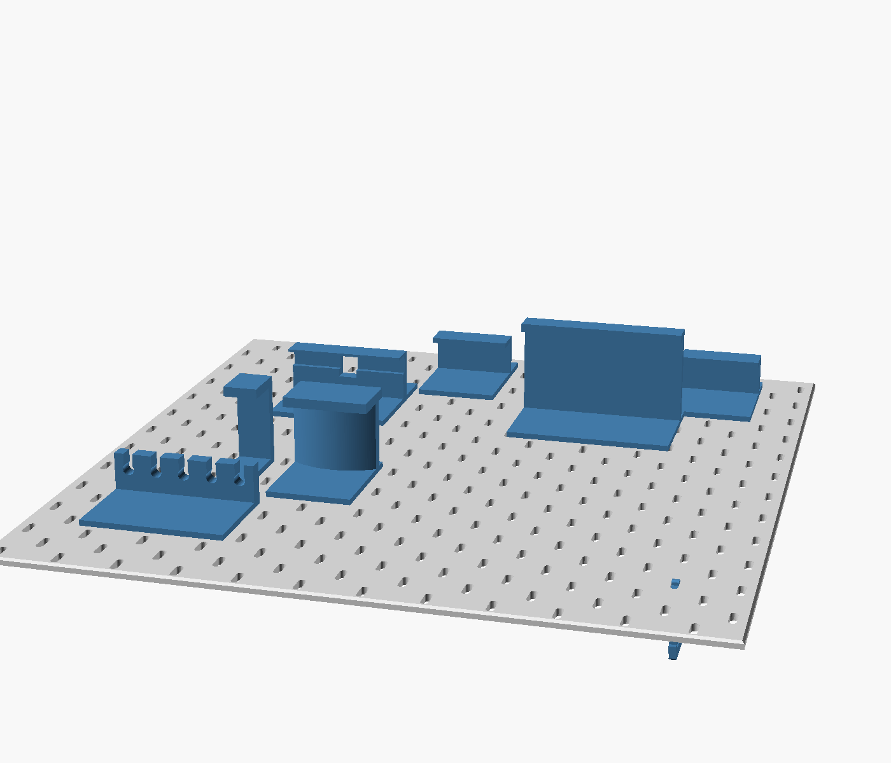

# SKÅDIS-compatible pegboard tiles for the desk (optional, our own)

Printed pegboard tiles that take IKEA's SKÅDIS hooks, clips and containers, assemble into one board of any size with finished outer edges, lock together at every joint, and stand on the desk in the MakerWorld clamp mount (model 2780289). Not in the assembly manual. File names carry the print count (`-x1`: one per board of that shape; `-x24`: keys).

## Geometry

IKEA does not publish the hole pattern; these are the community measurements every compatible design uses. Check one IKEA hook on the first tile before printing the rest.

| | mm |
| --- | --- |
| Board thickness | 5 |
| Slot | 5 wide × 15 tall, vertical, rounded ends |
| Pitch along a row | 40 |
| Rows | 20 apart, every other row shifted 20 (a 40 × 40 grid plus one at its centres) |
| Tile | 6 × 6 cells = 240 × 240 (252 tall with the skirt); a P1S or A1 bed is 256 |

The pattern sits 10 mm in from every tile edge, so across a joint the neighbour's first slot is exactly 40 mm from this tile's last, in both directions: one board, no seam in the pattern.

## The lock (so nothing falls out, front or back)

Three bow-tie keys per joint, in pockets cut from the **back** of both tiles, 3.5 mm deep, leaving a 1.5 mm skin on the front.

- The dovetail stops the tiles pulling apart.
- The pocket floor holds the two faces flush, so a hook never catches a step.
- The front skin means nothing shows and nothing can come out the front.
- A 0.3 mm lip round the back of each pocket snaps over the key: push it in with a thumb until it clicks, and it cannot fall out the back.

Keys sit at cell corners (40, 120, 200 mm along each edge), where the pattern leaves 2 mm of solid on each side.

The keys also keep the pattern true across the joint. The pockets are cut in the same print as the slots, on the same 40 mm grid, so a seated key holds the two tiles within 0.1 mm of each other along the joint, and butting the edges fixes them across it. The neighbour's first slot then lands exactly 40 mm from this tile's last, row after row, however many tiles you add. The key is 13 × 11 mm with a 5 mm waist, 3.4 mm thick. A 0.1 mm slop is built in; if a key is tight, a tap with a mallet seats it; if loose, a drop of CA glue.

## The desk mount (MakerWorld 2780289, measured from its 3MF)

The board rests on the foot frame's ledge, 12 mm above the desk, with the frame's 40 × 12 mm upright behind it and its 60 × 4 mm foot plate on the desk. The frame screw's 4.8 × 14 mm shank goes through any slot of the bottom row into the frame's window, nut behind. So the slots need no change, and bottom tiles get a 12 mm **skirt** with a straight bottom edge that sits flush in the clamps and reaches the desk. No notches by default; if a frame's foot plate ever needs clearance, `notches = [x, x, ...]` (mm from the tile's left edge) cuts a 40 wide notch for the upright and a 60 × 4 one for the plate. `lift = 0` removes the skirt.

## Pieces

| File | Where | Outside edges |
| --- | --- | --- |
| `skadis-TL-x1.stl` `skadis-T-x1.stl` `skadis-TR-x1.stl` | top row | top (+ left / right) |
| `skadis-L-x1.stl` `skadis-C-x1.stl` `skadis-R-x1.stl` | middle rows | left / none / right |
| `skadis-BL-x1.stl` `skadis-B-x1.stl` `skadis-BR-x1.stl` | bottom row, with the skirt, straight bottom edge | bottom (+ left / right) |
| `skadis-L1-x1.stl` `skadis-M1-x1.stl` `skadis-R1-x1.stl` | single-row board, with the skirt | top and bottom (+ left / right) |
| `skadis-key-x24.stl` | every joint, 3 each | |
| `skadis-cross-x4.stl` | every inside corner where four tiles meet, on the back, glued | |
| `skadis-bridge-h-x4.stl` `skadis-bridge-v-x4.stl` | joint ends at the board's edge, on the back, glued (optional) | |
| `rib-*.stl` | the back, glued: see Making it stiff | |

Outside edges are chamfered 1.5 mm on the front and have no pockets. Joint edges have the pockets. A tile is 331 g (346 g with the skirt), a key 0.7 g.

Boards and what to print:

| Board | Tiles | Keys |
| --- | --- | --- |
| 2 wide × 1 tall (48 × 25 cm) | L1, R1 | 3 |
| 3 wide × 1 tall (72 × 25 cm) | L1, M1, R1 | 6 |
| 2 × 2 (48 × 49 cm) | TL, TR, BL, BR | 12 |
| 3 × 2 (72 × 49 cm) | TL, T, TR, BL, B, BR | 21 |
| 3 × 3 (72 × 73 cm) | TL, T, TR, L, C, R, BL, B, BR | 36 |

Two frames hold a 2-wide board, three a 3-wide one, one under each bottom tile. With ribs, the loose-key count drops to 12 for a 3 × 3 (see Making it stiff).

## Print

Tiles: **front face down, as saved**, 0.2 mm layers, 3 to 4 walls, 3 top and bottom layers, 15 to 20 % gyroid, PETG; the textured plate becomes the front. No supports. Keys: flat as saved, same profile (a 13 × 10 × 3.4 key is nearly all walls anyway), print the whole `-x24` plate; spares weigh nothing.

    openscad -D 'pos="BL"' -o skadis-BL-x1.stl skadis-tile.scad      # TL T TR L C R BL B BR L1 M1 R1
    openscad -o skadis-key-x24.stl skadis-key.scad

Assembly: lay the tiles face down on a flat surface, butted, pattern lined up by eye (the pockets line up when the slots do), push a key into each pocket pair until it clicks, turn the board over. Stand it on the frames, frame screw through a bottom-row slot, nut behind.

First print: one BL tile and three keys. Hang an IKEA hook on it, click a key in and out, set it in a clamp. Then print the rest. A 2 × 2 board takes about 1.35 kg.

## Making it stiff (print these: the ribs)

A 5 mm printed tile is bendier than IKEA's fibreboard, every joint between tiles is a hinge, and the whole board stands on clamps along its bottom edge. Left like that, a 3 × 3 board sways when you hang something on it. The fix is ribs glued to the back, and they cost nothing on the front.

**Why ribs can go on the back at all.** The slots sit in columns at 10 and 30 mm (and every 40 after) from a tile's edge, so the back of a tile is solid, top to bottom, in 15 mm wide bands centred on every 20, 40, 60 ... mm, and on the joint lines themselves. A 12 mm rib in such a band covers no slot and stays 1.5 mm clear of the slots either side, where IKEA's hook tabs drop behind the board. Every slot still takes a hook. Level ribs are impossible: the solid band between rows is 5 mm and sits right under a row of slots.

**What they do.** A rib down each upright joint makes that joint rigid along its whole length. Ribs down the middle of each tile cross the level joints and stiffen the board top to bottom. The ribs are staggered so every level joint is crossed. Together they make a 3 × 3 board roughly twenty times stiffer against a push on its top edge. The ribs are 12 wide and 20 deep; stiffness grows with the cube of the depth, so do not make them shallower.

**They carry their own keys.** A rib covers the pockets of the joint it sits on, so it has the bow-tie keys built in, the original fit you liked, and drops into the pockets instead of loose keys. The keys locate it, the glue holds it. A 3 × 3 then needs only 12 loose keys (the level-joint pockets no rib crosses) instead of 36. For a joint whose keys are already in, `rib-240-k0.stl` is the same rib flat; glue it over the keys.

| File | Print (3 × 3) | Where (mm from the board's bottom edge, skirt not counted) |
| --- | --- | --- |
| `rib-240-k3-x4.stl` | 4 | upright joints, 80 to 320 and 320 to 560 |
| `rib-80-k1-x2.stl` | 2 | upright joints, 0 to 80 |
| `rib-160-k2-x2.stl` | 2 | upright joints, 560 to 720 |
| `rib-240-k1-x6.stl` | 6 | tile centres (120, 360 and 600 mm from the left edge), 120 to 360 and 360 to 600 |

For a 2 × 2: one upright joint (80 + 240 + 160: `k1` 1, `k3` 1, `k2` 1) and two centre bands crossing one level joint (`rib-240-k1` 2). For a single-row board: one `rib-240-k3` per joint, keys up, no centre ribs. The centre ribs start 120 mm up so they clear the clamp frames' uprights (113 mm tall) at the bottom. The ends of the upright-joint ribs fall at 80, 320 and 560, between pockets.

Fitting: tiles face down, loose keys in the level-joint pockets that no rib covers (40, 200, 280, 440, 520, 680 mm along each level joint). Dry-fit every rib: its keys find the pockets, press it until it clicks like a key. Lift each rib in turn, run a bead of CA down both sides of where it sat, press it back and hold for 30 s. Leave the board flat for an hour. Rib fit was checked on the tile models: the body touches nothing, and each key meets the pocket lip by the same 0.2 mm the loose keys do.

If the board stands with its back toward a wall, add two `skadis-wall-standoff-x2.stl` at the top corners (glued in a solid band) and the last of the sway goes, because the board is then held at the top as well as at the clamps. Measure the gap from the board's back to the wall at the top, subtract 3 mm for a felt pad, set `reach` in the source, print two. With ribs and standoffs the weak point left is the clamps' own grip on the top.

Print the ribs on their outer face, as saved (keys up), PETG, 3 walls, 15 to 20 % gyroid. About 35 g each.

    openscad -D L=240 -D 'keys=[40,120,200]' -o rib-240-k3-x4.stl skadis-rib.scad
    openscad -D L=240 -D 'keys=[120]' -D along=true -o rib-240-k1-x6.stl skadis-rib.scad

## The corner cross and bridges (optional, the ribs do more)

With ribs fitted these are not needed; they remain for a board without ribs or as extra insurance. Their plates are notched clear of the zone 12 mm under every slot they would otherwise cover, where an IKEA hook's tab drops behind the board, so every slot around a bracket still takes a hook. The cross keeps its 180° symmetry (it fits either way up).

`skadis-cross-x4.stl` (source `skadis-bracket.scad`): a 73 × 42 × 2 mm plate with four pegs, one into a slot of each of the four tiles that meet at an inside corner. It goes on the back and is glued in. The keys hold the tiles together. The cross stops the corner from hinging and makes the board one stiff panel.

- **Pegs** are 4.8 × 14.8 mm, 0.1 mm smaller all round than the slot so CA glue has room. They are 5 mm tall, the board's thickness, so they finish flush with the front and the corner reads as solid board.
- **Where they go**, relative to the corner: 10 left and 10 down, 10 right and 10 up, 30 right and 10 down, 30 left and 10 up. These are the four slots nearest the corner, one per tile. The cross fits either way round. It cannot go in sideways because the slots only take it upright.
- **What it costs**: its own four slots. The plate stays 1.5 mm clear of every other slot, so the rest of the corner still takes hooks.
- **How many**: one per inside corner. See the table below.

Fitting:

1. Assemble the board face down with all keys in.
2. Dry-fit the cross over the corner and check the pegs are flush on the front.
3. If a peg stands proud, set `proud = -0.1` and reprint.
4. Lift the cross out, put a thin line of CA glue (or a dot on each peg) on the plate, and press it home.
5. Hold it for 30 s and leave the board flat for an hour.

Print the cross plate down, pegs up, as saved, in PETG. Use 100 % infill, because it is 3 g and should be solid. No supports.

    openscad -D 'type="cross"' -o skadis-cross-x4.stl skadis-bracket.scad

### The bridges (two pegs, for joints that reach the board's edge)

`skadis-bridge-h-x4.stl` crosses an upright joint: a 61 × 21 stadium with two pegs side by side, 40 apart. `skadis-bridge-v-x4.stl` crosses a level joint: 21 × 71 with two pegs one above the other. Same plate, pegs, fit and glue as the cross. Each stays about 2 mm clear of every other slot.

Where they go: the cross braces each joint at the inside corner, so the bridge goes at the joint's other end, where it meets the board's outside edge. Count the slot rows in from that edge. The bridge's two pegs go in the two slots of the **4th row** that sit either side of the joint, 70 mm in. For a level joint, count columns instead. On a single-row board there is no cross, and each joint reaches both the top and the bottom edge, so it gets two bridges: the 4th row from the top and the 4th row from the bottom. The skirt does not count as a row. The bridge fits only one way: if the pegs don't drop into two slots, you are on the wrong row.

| Board | Cross | Bridge-h | Bridge-v | Slots used |
| --- | --- | --- | --- | --- |
| 2 wide × 1 | 0 | 2 | 0 | 4 |
| 3 wide × 1 | 0 | 4 | 0 | 8 |
| 2 × 2 | 1 | 2 | 2 | 12 |
| 3 × 2 | 2 | 4 | 2 | 20 |
| 3 × 3 | 4 | 4 | 4 | 32 |

The files are named for a 3 × 3. Mount frames stand under the middle of a bottom tile, at least 50 mm from any joint, so they never meet a bridge. The tallest frame piece is 113 mm.

## Accessories (all on one proven hanger)

Everything hangs the IKEA way, from `skadis-lib.scad`: a 4.6 mm tab through a slot with a lip that drops 5.9 mm behind the board, and a short peg in the slot 40 mm below so the piece cannot tip, swing or lift by accident. Lift it 6 mm to take it off. Anything that carries weight has two hangers, 40 mm apart, in two slots of one row. Every piece was placed on the tile model, raised and dropped, and touches nothing but the slots (and the check was shown to catch a 2 mm error). All print on their side as saved, with no supports, because every wall stands upright in that pose.

| File | What | Print |
| --- | --- | --- |
| `skadis-headset-hook-x1.stl` | 60 wide, 55 reach, two hangers; the arm is crowned 9 mm across its width so a headband sits centred and the pads hang free | PETG, 4 walls, 30 % |
| `skadis-controller-hook-x1.stl` | 24 wide, 60 reach, 25 tip, one hanger: the pad goes between the grips, the controller hangs face out | same |
| `skadis-shelf-120-x2.stl` | 120 × 70 shelf, 12 mm lip, two hangers, gussets under them; a couple of kilos | PETG, 4 walls, 25 % |
| `skadis-keyboard-perch-x2.stl` | a pair: parks the keyboard on the board, on edge, leaning back on it. 30 deep, 16 lip, takes 26 mm thick. Hang both in one row, 5 columns (200 mm) apart for a 75 % board | PETG, 4 walls, 30 % |
| `skadis-phone-dock-x1.stl` | phone stands in a 14 mm channel 20 mm out and leans back about 10°; a notch under it for the charging plug, the lead runs down behind the step | PETG, 4 walls, 25 % |
| `skadis-cable-comb-x1.stl` | five 8 mm fingers with 6.5 mm necks: leads clip in from the front and stay | PETG, 4 walls, 30 % |
| `skadis-hook-x4.stl` | narrow J-hook, 40 reach, one hanger (the same geometry, built before the library) | on its side, 4 walls, 40 % |
| `skadis-cable-clip-x6.stl` | back cable clip: a split peg pushes into any slot from behind and grips; an 8 mm open ring carries leads down to the wall gap. Nothing shows on the front | standing on an end |
| `skadis-wall-standoff-x2.stl` | see Making it stiff | standing on the disc, 100 % |

To change a size, edit the number at the top of the source (`reach`, `W`, `D`, `lip`, `cable` ...) and re-render; the hanger never changes.

    openscad -D 'kind="headset"' -o skadis-headset-hook-x1.stl skadis-arm-hook.scad
    openscad -o skadis-shelf-120-x2.stl skadis-shelf.scad     # perch, phone-dock, cable-comb, hook, cable-clip, wall-standoff the same way

## Should you use a generator online instead?

Not for the board. The pattern is four numbers that every generator shares; what the generators do not give you is the seamless joint, the lock, the finished edges and the skirt for the mount. For accessories (bins, hooks, holders) use the published ones: `makerworld.com/en/models/799571` (parametric bins and shelves), the Printables "Parametric Skadis Board" family, and openGrid's SKÅDIS adapter if you want openGrid parts on it.

## openGrid, bigger tiles

The biggest openGrid Lite tile a 256 mm bed takes is 9 × 9 cells (252 × 252 mm). `components/underware/` carries `tile-9x9-lite.stl` and `tile-8x9-lite.stl` for a wall or a cabinet side; the Underware plan under the desk stays on 8 × 4 tiles.
