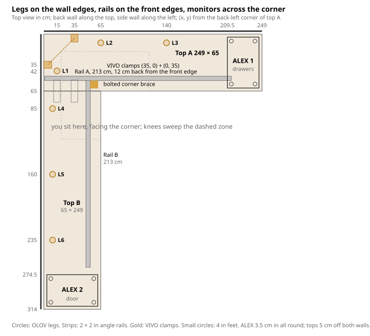

# L-Shaped EKBACKEN Desk — Design Review

Oct 19, 2026 · @Scott Howson

## Verdict in five lines

1. Buy neither the C-channels nor the four 6 ft tubes. Two lengths of 2 × 2 × 3/16 in hot-rolled steel angle, 84 in (213 cm) each, are ordered from Metal Supermarkets Ottawa for pickup: $142.68 plus tax, $161.22, cutting included (19 Oct). Acier Terrebonne would have been $80 but does not ship and is a 3 h drive; delivery from Ottawa was $150.
2. One angle rail runs under each top's front edge, set 12 cm back, and the two rails are joined at the inside corner by two 5 mm gusseted strut fittings, one each side of rail B's end, bolted to the vertical legs with 3/8 in bolts. That bolted joint, not the joining plates, carries the inside corner.
3. Your six OLOV legs go along the back wall edge and the side wall edge, none in the knee zone (a seventh in the back corner was proposed and dropped on 19 Oct; see E); the two ALEX units, each on four 4 in round adjustable feet, sit centred under the two far ends with 3.5 cm of top showing all round. Set every OLOV to 80.2 cm so the tops sit level on the spacers: top surface at 83.0 cm. You sit at the inside corner facing the diagonal: the Samsung Odyssey G5 hangs across the corner, the two Acers wrap along each wall with an Edifier under each, and the Y60 sits over ALEX 1. The tops stand 3 cm off both walls so the VIVO clamps have room behind the edges.
4. Every rail screw into the top is a #10 × 1 in wood screw in a pilot hole, penetrating 20.6 mm of the 28 mm top; no fastener reaches the laminate.
5. Expected worst-case flex at the inside corner is about 2–3 mm (my estimate, not verified); add a seventh OLOV under either rail only if that bothers you.

Everything below separates **IKEA's published guidance** from **my engineering estimates**, and ends with the measurements you still need to take before drilling.

Step-by-step with every measurement: [Build manual](build-manual.md)

## 1. Verified IKEA specs vs. your brief

Your numbers are right; the only new item is a 12 kg "max load" figure IKEA lists on the ALEX drawer unit, discussed below.

| Component | IKEA published figure | Your brief | Source |
| --- | --- | --- | --- |
| EKBACKEN countertop (NA) | 98 in × 25⅝ in × 1⅛ in (249 × 65 × 2.8 cm); laminate on particleboard | Matches | [IKEA US](https://www.ikea.com/us/en/catalog/products/60395447/) |
| EKBACKEN support rule | Legs required when overhang exceeds 10 in (25 cm); max 32 in (80 cm) between supports | Matches | [IKEA US](https://www.ikea.com/us/en/catalog/products/60395447/) |
| ALEX drawer unit | 36 × 58 × 70 cm (14⅛ × 22⅞ × 27½ in); max load 12 kg; max 4 kg per drawer | Matches dims; load figure new | [IKEA](https://www.ikea.cn/cn/en/p/alex-drawer-unit-white-40473549/) |
| ALEX storage unit (door) | 36 × 58 × 70 cm; finished back; 1 adjustable shelf | Matches | [IKEA](https://www.ikea.com/th/en/p/alex-storage-unit-black-brown-50563766/) |
| OLOV leg (ordered, qty 6) | Adjustable 60–90 cm, max load 13 kg each, screws included, for tops ≥ 25 mm | Matches | [IKEA](https://www.ikea.com/lv/en/p/adils-leg-black-70217973/) |

Your IKEA order sheet (19 Oct) shows OLOV legs rather than the ADILS in the brief, plus an [ELLOVEN monitor stand with drawer](https://www.ikea.com/ee/en/p/elloven-monitor-stand-with-drawer-white-50474770/) (47 × 26 × 10 cm, 20 kg max). The spacers are round stainless adjustable cabinet feet, about 5 cm diameter and 10.16 cm tall with a square screw plate: use four per ALEX, plate screwed to the underside of the top, pad resting on the ALEX. Your joining plates are 10 × 3 in flat mending plates (4 pcs); two go across the joint, two go under the monitor-mount clamp jaws. On the desk: a NuPhy Air75 V2 and an 80 × 30 cm deskmat. Your Amazon order adds a Samsung Odyssey G5 32 in 1000R curved (centre; VESA 75, about 5 kg; replaced the Smart M7 on 21 Oct), two Acer XZ320QU 31.5 in curved QHD (sides), a VIVO STAND-V300CU clamp-on dual-pole triple mount (centre up to 49 in / 59.4 lb flat or 48.4 lb curved, max centre-screen height 26.5 in; sides up to 38 in / 17.6 lb each, 29.5 in reach each; 24 in poles of 1.4 in diameter) and an ELYONA swing-arm lamp. Three 32 in panels make an array about 2.1 m wide; across the corner it wraps 1 m along each wall.

**Height.** ALEX (70.0) plus a 4 in spacer (10.16) puts the underside of the top at 80.2 cm and the surface at 83.0 cm. Every OLOV is set to 80.2 cm, inside its 60–90 range, and fine-tuned to the spacers, not the reverse. 83 cm is a tall seated height; it suits someone around 185 cm or more, or a chair raised to about 52 cm with a footrest. Optional printed ALEX feet (`parts/accessories/alex-foot.scad`, 2, 4 or 6 cm, four per unit under the bottom corners, three screws up through wells in the solid column, marked by the corner template's inner holes) raise the whole desk by their height with every OLOV reset to match: underside 82.2 / 84.2 / 86.2, surface 85.0 / 87.0 / 89.0, rail lower edge 77.1 / 79.1 / 81.1. The 6 cm feet put the OLOV at 86.2 of its 90 cm maximum. Each foot carries about 25 kg, a quarter of a loaded cabinet plus its share of the desk, on a solid 56 mm PETG column; the three #6 screws only locate it.

**Capacity.** Six OLOV at 13 kg = 78 kg of leg capacity, far less than ADILS would give. The legs carry roughly 30 kg of top plus what sits over the wall edges, including the triple-monitor mount (about 30 kg of monitors and poles, clamped at the corner of top A near legs L1 and L2). The HYTE Y60 (≈ 12–15 kg loaded) sits over ALEX 1 and the Edifiers (≈ 10 kg) within 40 cm of the corner legs, so the legs stay well under rating. Don't park the Y60 mid-wing. The 12 kg ALEX figure almost certainly refers to what you place on the unit's own top, not its ability to carry a desk IKEA itself sells it under (LAGKAPTEN/ALEX combinations). **Confirm both on the IKEA Canada pages for your article numbers.**

**Top weight (my estimate).** 249 × 65 × 2.8 cm of particleboard at \~650 kg/m³ is roughly 29 kg per top, 58 kg for both. Each support carries a share of that plus whatever sits on the desk.

**Fastener depth.** 28 mm top, \~1 mm laminate face. Rule used throughout: screw penetration into the top ≤ 21 mm, leaving ≥ 7 mm of core under the laminate.

## A. Recommended design: back-edge legs plus two bolted front rails

The design puts every leg against a wall edge, carries both front edges on steel angle rails, and ties the rails together at the inside corner with a bolted bracket. The joining plates stay, but only to keep the two surfaces flush.

**Why legs can't be where IKEA's rule wants them.** IKEA's 32 in spacing assumes supports that run the full depth of the top (cabinets, or leg pairs front and back). A leg only at the back leaves the front edge hanging 55 cm beyond it, far past the 10 in overhang limit. Legs at the front edge every 32 in would sit exactly where your knees go. So the front edge needs a beam, not more legs: a steel rail under each front edge, running from the inside corner to the far end, whose reactions pass through its screws into the top and from the top into the nearby OLOV legs and the feet plates standing on the ALEX units.

**What carries what (load path).**

- Back edge of top A and wall edge of top B: three OLOV legs on A (one of them in the corner square, under VIVO clamp 2) and three on B at ≤ 75 cm spacing, plus the ALEX units at each end. This meets IKEA's spacing rule along those edges.
- Front edge of top A: rail A, a 2 × 2 × 3/16 in angle, 213 cm, screwed to the underside 12 cm back from the edge; the 10 cm feet lift the top enough that the rail passes over the ALEX with 5 cm to spare. Neither rail touches a cabinet: each rail's end load goes up through its last screws into the top and down through the nearest feet plates. Rail A ends at x 214, half a centimetre from feet F1 and F3 at x 214.5, and its wall end is 6 cm from leg L1. The 12 cm strip beyond the rail is a cantilever within IKEA's 25 cm limit.
- Front edge of top B: rail B, same angle, 213 cm, ending at y 266, 13.5 cm short of feet F5 and F6 at y 279.5 (ALEX 2's near face is at 274.5): the top bridges that 13.5 cm, a 28 mm board carrying about 15 kg at roughly 0.3 MPa if the full 65 cm width is counted (a simplified full-width bending estimate; the last screws load a narrower strip first, still far below the board's 11 MPa rupture), and the feet carry it on. At the corner the rail hangs from the fittings bolted to rail A. Rail B also crosses the joint, so it acts as a third, much stiffer joining plate.
- Inside corner of top B: rail B → bolted corner fittings → rail A → L1 and ALEX 1. Steel-to-steel bolts, no particleboard screw in the corner joint itself; the rail reactions do then pass through screws and particleboard into the feet plates, as above.
- Racking: the two ALEX boxes, locked to the tops at opposite ends of the L by the feet pads sitting in printed rings, brace the whole frame; the telescoping OLOV legs contribute even less against sideways push than ADILS would.

**Why angle instead of square tube.** For the same wall thickness, a 2 in angle is stiffer than a 1¼ in square tube (moment of inertia 0.27 in⁴ vs about 0.12 in⁴), it costs about the same per foot, and it needs one hole per screw instead of a clearance hole in one wall and a larger access hole in the opposite wall. The vertical leg also gives a flat face for the corner brace. A 2 × 2 × 1/8 in square tube (about 0.5 in⁴) would have been stiffer still, but Acier Terrebonne does not ship to Gatineau and Metal Supermarkets' tube prices were double the angle's. The trade-off is 5.1 cm of depth below the top; section E covers the knee-clearance check this forces. An angle on its own bends unsymmetrically (its principal axes lie at 45°), which would make it softer than the catalogue I suggests; here the flat leg is screwed to the top every 26 cm, and the top holds that leg straight, so the rail bends vertically and the 0.27 in⁴ figure applies, with the top adding about 15% of its own. Estimate of the restraint: holding the leg straight takes a sideways force of the same order as the vertical load, about 30 N per screw across nine #10 screws, against several hundred newtons of shear capacity each; the screw-hole fit and the board's local bearing are what actually deliver it, and both are stiff at that load, but this has not been measured.

**Why not a wood apron.** A 2 × 4 on edge is as stiff and cheaper, but it hangs 9 cm, needs pocket screws or brackets to fasten without a jig, and looks like what it is. If the clearance check in E fails for a 2 in angle, a 1½ × 1½ × 3/16 in angle (3.8 cm deep) is the fallback, with about 70% more flex.

**Rejected alternatives.**

- C-channel stiffeners (Option A): made to be let into a ¼ in × ¾ in dado in a slab 1¼ in thick or more ([Lee Valley](https://www.leevalley.com/en-ca/shop/hardware/table-hardware/brackets-and-supports/116623-c-channel-tabletop-stiffeners)). A 28 mm particleboard top can't take that dado. Surface-mounted they are just an expensive 2 × 1 in channel, four 52 in pieces don't span your 208 and 213 cm runs without splicing, and the Canadian-made 52 in version lists at CAD $79.95 each ([KJP Select Hardwoods](https://kjpselecthardwoods.com/products/c-channel)). About $320 for a worse fit.
- Four 6 ft square tubes (Option B): workable, but 24 ft is nearly double what the layout needs, the 1¼ in section is less stiff than the angle, and every fastener needs two holes. If you strongly prefer the look, buy two 7 ft tubes of 1½ × 1½ × ⅛ in (0.22 in⁴) and follow the same layout; the drilling steps in D note the differences.
- A leg at the inside corner: solves everything structurally and is exactly what you asked to avoid. Kept only as the optional extra-leg upgrade in E.
- A commercial frame: not needed; the parts you own can be made to work.

## B. Support layout

Top A runs along the back wall and takes the corner square; top B butts into A's front edge. Both tops stand 3 cm off their walls. You sit at the inside corner facing the diagonal: the VIVO poles clamp to A's back edge at x 40 and to A's left end edge at y 40, the crossbar runs across the corner, the Samsung Odyssey G5 hangs on the diagonal with the ELLOVEN under it, and the Acers wrap along each wall with an Edifier beneath each. The Y60 sits on top A over ALEX 1; the lamp sits beside the Y60 on top A; the headset stand and plant go on top B. If your longer wall is the other one, mirror the whole layout. Coordinates are (x, y) in cm from the back-left corner of top A: x along the back wall, y along the side wall.

Six legs sit along the two wall edges, one of them in the corner square under VIVO clamp 2, and nothing stands in the knee sweep; the two rails carry the front edges between the wall legs and the ALEX units.

| Support | Centre or footprint (x, y) cm | From nearest edges | Note |
| --- | --- | --- | --- |
| ALEX 1 (drawer unit) | x 209.5–245.5, y 3.5–61.5 | 3.5 cm in from A's right end, front and back edges | drawers face you (+y); Y60 sits above it |
| ALEX 2 (storage unit) | x 3.5–61.5, y 274.5–310.5 | 3.5 cm in from B's far end, wall edge and front edge | door faces you (+x) |
| Feet on ALEX 1 | centres (214.5, 8.5), (240.5, 8.5), (214.5, 56.5), (240.5, 56.5) | 5 cm in from each ALEX corner | plate screwed to the top's underside; 5 cm pad sits in a printed ring screwed to the ALEX top |
| Feet on ALEX 2 | centres (8.5, 279.5), (56.5, 279.5), (8.5, 305.5), (56.5, 305.5) | 5 cm in from each ALEX corner | same |
| L1 | (15, 42) | 15 from A's left end; 6 cm behind rail A | under VIVO clamp 2; its 11 cm plate ends at x 9.5 and y 47.5, clear of the clamp jaw (to x 8.9) and rail A (from y 48) |
| L2 | (65, 10) | 10 from back edge | nearest leg to VIVO clamp 1 |
| L3 | (140, 10) | 10 from back edge; 69.5 to ALEX 1 |  |
| L4 | (10, 85) | 10 from side-wall edge; 20 past the joint | takes the joint's wall end on B's side |
| L5 | (10, 160) | 10 from side-wall edge |  |
| L6 | (10, 235) | 10 from side-wall edge; 39.5 to ALEX 2 |  |
| VIVO clamp 1 | x 36–44 on A's back edge, jaw under y 0–9 | centred 40 from A's left end | grips the top plus a 10 × 3 in plate pad |
| VIVO clamp 2 | y 36–44 on A's left end edge, jaw under x 0–9 | centred 40 from A's back edge | same (clamp back 8 cm long, 1.75 cm behind the edge, measured); the poles are 50.2 cm apart on the diagonal (crossbar 19¾ in centre to centre, measured 21 Oct) |
| Clamp pads | spare mending plates at x 20.0–45.4, y 0.5–8.1 and x 0.5–8.1, y 20.0–45.4 | 2.5 cm clear of rail A; the 8 cm jaws (36–44) sit fully on them | flat against the underside, no screws |
| Rail A | x 1–214, flat leg y 48–53, vertical leg at y 53 | 12 cm back from A's front edge | 213 cm |
| Rail B | y 53–266, flat leg x 48–53, vertical leg at x 53 | 12 cm back from B's front edge | corner end against rail A's vertical leg; first 12 cm lie under A, crossing the joint; stops 8.5 cm short of ALEX 2 |
| Corner fittings | two 5 mm gusseted 90° strut fittings, one on the outside corner (A's vertical leg toward +x, B's outer face) and one on the inside corner (A's vertical leg toward −x, B's inner face) | rail B's end sandwiched between them, 29 mm below the top | 3/8 in bolts: four through rail A, two through rail B and both fittings |
| Joining plates | 10 × 3 × 0.12 in, centred x 15 and x 35, spanning y 53.3–78.7 | long axis across the joint; four holes along the plate at 2.0, 7.0, 18.4, 23.4 cm from one end, landing at y 55.3 and 60.3 in A, 71.7 and 76.7 in B, all used | flushness only |

**IKEA spacing check (their rule: ≤ 80 cm between supports, ≤ 25 cm overhang).** Back edge of A: corner → 65 → 140 → 209.5: gaps 65 (overhang, see below), 75, 69.5. Wall edge of B: joint 65 → 85 → 160 → 235 → 274.5: gaps 20, 75, 75, 39.5. Side edge of A: corner → 42 → joint 65: gaps 42, 23. Front edges: the rule can't be met with legs without putting them in the knee zone, so the rails take over there; that is my engineering substitution, not IKEA's guidance. Overhangs: 12 cm beyond each rail, 3.5 cm beyond each ALEX, 10–15 cm beyond each wall leg, and the back-left corner tip, which is 43 cm from the L1–L2 line. That tip is the one knowing exception to the 25 cm rule: it carries only the ELLOVEN, and the mount's load goes into the clamps at the edges, which bear near L1 and L2, not at the tip. **Knee zone:** you sit at the inside corner, so your knees sweep the corner square and about 55 cm under each wing from the corner (x 20–120 under A, y 20–120 under B). Every leg is on a wall edge at least 10 cm outside that sweep.

## C. Bill of materials

Everything beyond what you own comes to roughly CAD $215–230 in parts (the steel at $142.68 is most of it), plus any of the tools you don't already have. Prices are approximate and tax-free; the steel price is the one to confirm first.

| Item | Spec | Qty | Approx. CAD | Source | Confirm? |
| --- | --- | --- | --- | --- | --- |
| Steel angle, rails | Hot-rolled equal angle 2 × 2 × 3/16 in (51 × 51 × 4.8 mm), 84 in (213 cm) each | 2 | $142.68 + tax = $161.22, cutting included | [Metal Supermarkets Ottawa](https://www.metalsupermarkets.com/ottawa/), 2275 Stevenage Dr, Mon–Fri 8–5, pickup | Ordered 19 Oct |
| Corner fittings | 90° gusseted strut fitting for 1-5/8 in channel, 5 mm steel, two 9/16 in holes per leg (sold in a 4-pack; two used) | 2 | $20–30 per pack | amazon.ca | Far stiffer than needed; they carry rail B's end in bolt shear, about 20 kg. The rails are template-drilled through them on the bench, so the fitting's hole spacing sets the bolt positions |
| Rail screws | #10 × 1 in pan-head wood screw, Robertson, zinc | 25 (19 used) | $6 | Canadian Tire / Rona / Home Hardware |  |
| Fitting bolts, rail A | 3/8-16 × 1¼ in hex bolt, zinc (through one fitting, the angle's vertical leg, two washers and a nylon-insert nut; 1 in would not clear the nut's insert) | 4 | $4 | Canadian Tire / Rona / Home Hardware |  |
| Fitting bolts, rail B | 3/8-16 × 1½ in hex bolt, zinc (through both fittings and the leg) | 2 | $2 | same |  |
| Fitting nuts | 3/8-16 nylon-insert lock nut | 6 | $4 | same |  |
| Fitting washers | 3/8 in flat washer (under head and nut) | 12 | $3 | same |  |
| Joining-plate screws | #10 × ⅝ in (16 mm) pan-head wood screw with #10 flat washer (the 10 × 3 in plates have oversized holes) | 8 | $3 | same | Skip if your plates came with screws ≤ 16 mm |
| Feet locating rings | 3D-printed (`parts/structure/foot-ring.stl`): 51 mm bore, 3 mm wall, 10 mm ring on a 75 mm × 2.5 mm flange, three countersunk #6 holes, open bottom; PETG or ABS | 8 | filament | printed at home | Replaces the corner braces, which could not bridge the 10 cm feet |
| Ring screws, into ALEX top | #6 × ⅝ in (16 mm) | 24 | $3 | Canadian Tire / Rona | ALEX top panel thickness (expect ≥ 16 mm) |
| Degreaser | Acetone or mineral spirits, small can, plus rags | 1 | $8 | same |  |
| Paint | Rust-Oleum or Tremclad flat black rust enamel, spray | 1 | $13 | same | Optional indoors but hot-rolled steel will mark things otherwise |
| Abrasive | 120-grit sandpaper or a scuff pad, for mill scale | 1 | $3 | same |  |

**Nothing more from IKEA.** Your two spare 10 × 3 in mending plates serve as the pads under the VIVO clamp jaws.

**Tools (buy only what you lack).**

| Tool | Why | Approx. CAD |
| --- | --- | --- |
| Corded or 18 V drill | all holes | owned? |
| HSS twist bits: 5/64 in, ⅛ in, 7/32 in, ¼ in, 7/16 in | ring pilots in the ALEX; pilot holes in the top; screw holes in the angle; step bit then the fitting bolt holes | $20 |
| Centre punch (a nail and hammer works) | keeps the bit from wandering on steel | $0–8 |
| Cutting oil or 3-in-1 oil | drilling steel without it dulls bits fast | $6 |
| Flat file | deburr cut ends and hole edges | $10 |
| Robertson #2 bit and a 3 in magnetic bit extension | reaches the screws beside the angle's vertical leg without the drill chuck hitting it | $5 |
| Two clamps, 6 in or larger | hold the rail against the top while screwing | $15 |
| Tape measure, combination square, masking tape, pencil | layout and depth stops | owned? |
| Spirit level | setting the OLOV legs and round feet level | owned? |
| Safety glasses | drilling steel throws chips | $5 |

**Not needed:** angle grinder, chop saw, tap-and-die, threaded inserts, welding, a router, or any of the C-channel insert hardware.

## D. Mounting and drilling

All steel drilling happens on the bench before anything touches the tops; the only holes made in place are the 1/8 in pilot holes through already-drilled rail holes. Don't start until section G's measurements are confirmed.

**Rail orientation.** Flat leg against the underside, vertical leg hanging down on the side nearer the front edge. Rail A: flat leg y 48–53, vertical leg at y 53. Rail B: flat leg x 48–53, vertical leg at x 53, corner end against rail A's vertical leg. The vertical leg is 12 cm from the front edge on both.

**Hole schedule (bench work).**

| Part | Hole | Size | Position | Count |
| --- | --- | --- | --- | --- |
| Rail A, flat leg | screw clearance | 7/32 in (5.6 mm) | 19 mm from the leg's free edge (32 mm from the heel); along the rail at 3.5, 28, 54, 80, 106, 132, 158, 184, 210.5 cm from the wall end (the first at 3.5 keeps 4 cm from the top's end) | 9 |
| Rail B, flat leg | screw clearance | 7/32 in | same offset; at 2.5, 7.5, 28, 54, 80, 106, 132, 158, 184, 210.5 cm from the corner end (the first two land in top A) | 10 |
| Rail A, vertical leg | fitting bolts | 7/16 in (11.1 mm) | on the bench, template-drilled through a fitting: heel at 52.0 cm from the wall end with legs toward the far end, then heel at 51.5 cm with legs toward the wall end; 29 mm down from the heel edge | 4 |
| Rail B, vertical leg | fitting bolts | 7/16 in | on the bench, template-drilled: heel at the corner end, legs toward the far end, 29 mm down; both fittings share these two holes | 2 |
| Tops, under each rail hole | pilot | 1/8 in (3.2 mm), 20 mm deep | through the rail hole, in place | 19 |
| Tops, joining plates | pilot | 1/8 in, 12 mm deep | through the plate holes, in place | 8 |

Edge clearances: screw holes sit 19 mm from the flat leg's edge and bolt holes about 22 mm from the vertical leg's bottom edge, both more than three hole diameters. Nothing is closer than 4 cm to any particleboard edge; the two rail-B screws into A's front strip are 4.5 and 9.5 cm from A's front edge. The wall-gap trim's #4 × ½ in screws go into the raw back edge itself, 14 mm below the surface, and are the one deliberate exception: they carry 30 g of plastic.

**Fastener depths (28 mm top, ≤ 21 mm penetration).**

| Fastener | Passes through | Into the top | Left under the laminate |
| --- | --- | --- | --- |
| #10 × 1 in rail screw | 4.8 mm angle | 20.6 mm | 7.4 mm |
| OLOV screws (IKEA, included) | leg plate \~3 mm | M4 × 16 mm fully threaded, about 13 mm into the top | fine as supplied; pilot 1/8 in, 15 mm deep |
| #8 × 5/8 in feet-plate screws | 1.5–2 mm plate | \~14 mm | \~14 mm |
| #10 × 5/8 in joining-plate screws | 3 mm plate | 13 mm | 15 mm |
| #6 × 5/8 in ring screws, into the ALEX top | 2.5 mm ring flange | 13.4 mm | ALEX top panel, not the desk top |
| 3/8-16 × 1¼ in and 1½ in fitting bolts | one or two 5 mm fittings plus the 4.8 mm vertical leg, washers and a nylon-insert nut | none | not applicable |

The VIVO clamp uses no screws at all: it grips the 2.8 cm top at the back edge, so keep the two clamp zones at the corner (x 36–44 on the back edge, y 36–44 on the left end, 9 cm in) free of legs and screws.

**Steps.**

1. Nothing to cut: both rails arrive at 213 cm. File both ends of each rail.
2. Mark the hole schedule on the flat legs with a square and tape measure, centre-punch each mark, and drill the 7/32 in holes at low speed with oil. Then the fitting bolt holes in the vertical legs, using one fitting as the template clamped with its heel on the stations in the schedule and its holes 29 mm down from the heel edge: punch through its holes, drill 7/16 in. Deburr every hole with the file or a larger bit turned by hand.
3. Degrease with acetone, scuff the mill scale, spray two light coats of enamel, and let them cure 24 h. Mask nothing; the holes clear themselves.
4. Top A face down on a blanket. Mark the four leg centres, the four feet centres under the ALEX 1 footprint, the two clamp zones (x 36–44 on the back edge and y 36–44 on the left end, keep 9 cm in from the edge clear) and the rail line (vertical leg at 12 cm from the front edge). Fit OLOV L1, L2 and L3 with the IKEA screws after a 1/8 in pilot in each hole, and pre-set each leg to 80.2 cm. Screw the four feet plates to the underside at their centres, pads pointing away from the top, and run each pad out so the foot measures 10.2 cm overall. Clamp rail A on its line, wall end 1 cm in from the top's end (x = 1), and drill the nine 1/8 in pilots through the rail holes with a tape flag 25 mm from the bit's tip (4.8 mm steel plus 20 mm). Drive the #10 × 1 in screws with the bit extension; stop when the head seats. A stripped hole in particleboard is not recoverable, so set the drill clutch low.
5. Top B face down. Fit L4, L5, L6 and the four feet for ALEX 2 the same way. Clamp rail B on its line with the corner end 12 cm past the top's end (that 12 cm will sit under top A). Pilot and screw holes 3 through 10 only.
6. Set both ALEX units in the room, ALEX 1 at x 209.5–245.5, y 3.5–61.5 (drawers toward you). With a helper, stand top A on L1–L3 with the four feet pads landing on ALEX 1's top, and adjust the OLOV legs and the feet until a level reads flat and all four pads bear. Before that, screw the four locating rings to ALEX 1's top at the foot centres so the pads drop into them.
7. Stand top B on L4–L6 and ALEX 2 (x 3.5–61.5, y 274.5–310.5, door toward you), slide it until its end meets A's front edge with the two surfaces flush, and adjust feet. Screw two of the 10 × 3 in mending plates across the joint from below, long axis across the joint, centred at x = 15 and 35 cm and at y = 66 (3 mm clear of rail A), through all four holes (two in each top), with #10 × ⅝ in screws and washers, pilots 12 mm deep.
8. Push rail B's corner end against rail A's vertical leg. Drill the two remaining 1/8 in pilots through rail B's holes 1 and 2 into top A, 20 mm deep, and screw.
9. Bolt on the two gusseted fittings; their holes in the rails were template-drilled in step 2. One in the outside corner (legs on rail A's vertical leg toward +x and on rail B's outer face), the other in the inside corner (legs on rail A's vertical leg toward −x and on the inner face of rail B's vertical leg, gusset under B's flat leg); both 29 mm below the top; turn the inside one gusset-down so nothing of it sits under the heads of rail B's screws 1 and 2 (the hole pattern is symmetric). Rail A: four 3/8-16 × 1¼ in bolts, washer under each head, washer and nylon-insert nut inside the leg. Rail B: two 3/8-16 × 1½ in bolts through fitting, leg and fitting, washers and nylon-insert nuts. Tighten fully, not snug: the fittings' 9/16 in holes leave 4.8 mm of play round each 3/8 bolt and the rails' 7/16 in holes 1.6 mm, so the corner holds by friction. 25 N·m (18 ft·lb) with a torque wrench, or one hand's full pull on a 15 cm wrench, then stop; only after rail B's end touches rail A and the two surfaces are flush. The mending plates align the tops; they do not carry the corner.
10. Retighten every screw after two weeks, as IKEA advises for ALEX and OLOV. Then clamp one VIVO pole at x 40 on A's back edge and the other at y 40 on A's left end edge, a spare 10 × 3 in plate flat under each jaw, so the crossbar runs across the corner. Hang the G5 on the centre bracket facing the diagonal, centred (36.5, 36.5), bottom edge 23 cm up, with the ELLOVEN beneath it at (36, 36), the Acers on the side arms along each wall toed in about 15°, their near ends about 12 cm from the G5's curved ends, an Edifier under each Acer (centres (108, 22) and (22, 108)), the deskmat and NuPhy centred on the diagonal in front of the ELLOVEN, the Y60 on top A over ALEX 1 (x 197.5–246.5, y 4.5–35.5, side glass toward you), the lamp on top A beside the Y60 (base (183, 20)), and the headset stand (28, 140) and plant (32, 298) on top B.

## E. Structural assessment

The six-leg plan without rails is inadequate: both front edges would hang 55 cm past the nearest leg, more than twice IKEA's 25 cm limit, and the inside corner of top B would have no vertical support at all. The rails and the bolted corner bracket are the minimum change that fixes both. Everything below is my estimate from standard beam formulas with A36 steel (E = 200 GPa) and a 28 mm particleboard top; nothing here has been load-tested.

| Failure mode | Finding | Margin or number | Action |
| --- | --- | --- | --- |
| Sag at the inside corner | Rail A spans 195 cm between L1 and ALEX 1 and carries rail B's corner reaction 38 cm from L1 | about 2–3 mm worst case with 2 × 2 × 3/16 angle (I = 0.27 in⁴) | acceptable; the optional seventh leg below cuts it by half |
| Sag along the front of B | Rail B spans 213 cm from the corner fittings to its end, and the load path continues 13.5 cm through the top to feet F5/F6, an effective span of about 226 cm | about 3 mm with 15 kg leaning mid-span | acceptable |
| Corner joint slip | the six 3/8 bolts sit in 7/16 in rail holes (1.6 mm play) and 9/16 in fitting holes (4.8 mm), so the corner holds by friction, not by the bolts bearing | estimate, not a measured capacity: 25 N·m with a dry torque coefficient of 0.2 gives roughly 13 kN per bolt (the nylon insert's prevailing torque and any lubrication move this either way); six bolts sharing equally at an assumed 0.3 friction coefficient for bare hot-rolled steel give about 20 kN against a corner reaction near 150 N. Even a quarter of that preload, unequal sharing and a coefficient of 0.15 leave a margin above 15 | tighten fully (manual step 7); retighten if the corner ever settles |
| Rail overload | 80 kg person sitting mid-span on rail A | bending stress ≈ 130 MPa vs 250 MPa yield, margin ≈ 1.9 | fine, but don't sit on the inside corner |
| Top between supports | 38 cm from back legs to rail, 28 mm board, laminated both faces | far below the 80 cm IKEA span | none |
| Overhang | 12 cm beyond rails, 3.5 cm beyond ALEX, 10–15 cm beyond wall legs | all within 25 cm | none |
| Fastener pull-out | #10 screws, 20 mm in particleboard, roughly 50–80 kg each (typical published range); 9–10 per rail | rails see mostly shear, not pull-out | none; the only pull-out case is the two screws into A's front strip, which the bolted corner fittings back up |
| Joint movement | Joint bridged by rail B (steel, 12 cm into A), two 10 × 3 in plates, and legs L1 and L4 within 25 cm either side | particleboard moves little with humidity | shim the two tops flush before fitting the plates |
| Racking (sideways push) | OLOV legs give almost no racking resistance; the two ALEX boxes, 2.6 m apart, fixed to the tops, do | adequate once the pads are captive in the rings on both ALEX units. Estimate: friction of eight pads under about 50 kg of top resists the first 150 N of a sideways push; beyond that each ring wall takes at most about 50 N from its pad, roughly 16 MPa of bending in a 3 mm PETG wall against the 50 MPa the filament is sold at: a nominal material comparison, before print orientation, layer adhesion and the wall-to-flange corner are allowed for, not a verified safety factor; its three #6 screws see the same 50 N in shear | don't skip the rings; look at them and their screws when you retighten at two weeks |
| Tipping | Mass ≈ 110 kg with ALEX units, low and spread; no support more than 30 cm inboard of any edge | not a risk | none |
| ALEX capacity | IKEA lists 12 kg max load on the drawer unit, but sells the same cabinet as one of the two supports of its LAGKAPTEN/ALEX desk, rated 50 kg spread over the top plus 15 kg on one spot, so the cabinet sees about 30 kg in IKEA's own product | ALEX 1 carries about 35 kg (a quarter of top A, the rail end, the Y60 and the lamp), ALEX 2 about 16 kg; each pad puts 0.04 MPa on the top panel, 5 cm from a side panel, 50 times under particleboard's crush strength; the panel's bending from a 9 kg pad 5 cm inboard of its supported edge is about 0.35 MPa against a rupture strength of 11 MPa or more, and the dowel-and-cam joint to each side panel sees about 180 N in shear across nine fasteners | none; the 12 kg is the rating for things set on the cabinet's own top, not for the cabinet as a desk support |
| Knee and thigh clearance | With the spacers the rail bottom sits at 75.1 cm, 12 cm back from the front edge | clears any seated thigh | resolved by the spacers; the 1½ in fallback is no longer needed |

**OLOV rating.** 13 kg each, 78 kg for six, against roughly 40–50 kg actually resting on the legs once the monitor array is up: a margin of 1.6–1.9. OLOV's inner tube can wobble a little at full extension; at 80.2 cm it sits at about two-thirds of travel, and the ALEX boxes and rails do the racking work as before.

**Triple-monitor mount (new).** Three 32 in panels plus the VIVO poles put about 30 kg on one clamp at A's back edge, with the screens 15–25 cm in front of the poles: a steady tipping moment of roughly 50–70 N·m on the clamp. Three consequences: L1 goes at (15, 42), 15 cm from clamp 2 at (0, 40), and clamp 1 at (40, 0) bears 27 cm from L2 at (65, 10), with estimated deflection under a clamp under 1 mm. A seventh leg at (14, 14) in the corner tip was in the plan until 19 Oct; Scott dropped it to use the six legs bought, and it is not needed because the clamps load the edges, not the tip; each clamp jaw gets one of your spare 10 × 3 in plates as a pad, because particleboard crushes under a bare steel jaw over months; and both clamps sit on top A's own edges, never on the joint. The corner arrangement puts the VIVO crossbar on the diagonal between the poles. VIVO's manual (STAND-V300CU REV1.1) shows this corner mounting, clamps on the two edges directly across the corner, and the clamps are independent C-clamps with no base bar. The pole spacing is fixed by the crossbar: measured 19¾ in (50.2 cm) centre to centre of its end collars; clamp centre = pole inset (4.5 cm assumed) + 50 ÷ 1.414 = 39.9, built as 40. Keep the centre screen's weight within the mount's rating (59.4 lb centre; the G5 32 in is about 5 kg, under the 48.4 lb curved limit) and both Acers under 17.6 lb each (5.6 kg with the stand, so about 5 kg / 11 lb on the arm).

**Optional seventh and eighth legs. An OLOV at (165, 48) under rail A**, just outside the knee zone and 48 cm from ALEX 1, cuts rail A's corner sag roughly in half; one at (48, 165) under rail B cuts rail B's sag by about 85%. Each is CAD $15 and four screws. Build without them first; add one only if the flex bothers you.

**What this assessment does not cover.** Actual ALEX load rating, actual OLOV plate size and screw length, the spacers' footprint and fastening, actual particleboard density and screw-holding of your specific tops, and the floor being level. Those are the measurements in section G.

## F. Purchasing decision

The two 2 × 2 × 3/16 in angles are ordered from Metal Supermarkets Ottawa ($161.22 with tax, pickup). Buy the gusseted strut fittings (one 4-pack, two used), the fasteners and finishing items in section C, and nothing else. Do not buy the C-channels or the four 6 ft tubes.

| Option | Cost (CAD, approx.) | Stiffness per rail (I, in⁴) | Drilling | Fit to a 28 mm particleboard top | Verdict |
| --- | --- | --- | --- | --- | --- |
| A. Four 52 in C-channel stiffeners | $160–320 | \~0.1 (2 × 1 in, 3/16 wall) | none, but needs a ¼ × ¾ in dado and threaded inserts | poor: the dado would leave \~9 mm of core; surface-mounted, four 132 cm pieces need splicing to span 208 and 213 cm | don't buy |
| B. Four 6 ft tubes, 1¼ × 1¼ × ⅛ in | $90 | \~0.12 | two holes per screw (clearance plus ⅜ in access), 36 holes | workable; 24 ft is almost twice what the layout uses, and 6 ft (183 cm) pieces are too short for either rail without splicing | don't buy as specified |
| B'. Two 7 ft tubes, 1½ × 1½ × ⅛ in | \~$55–65 | \~0.22 | same two-hole drilling, 38 holes | workable; 3.8 cm deep, so better knee clearance than the angle | acceptable second choice if you prefer the look or need the clearance |
| Recommended: two 7 ft angles, 2 × 2 × 3/16 in | $142.68 at Metal Supermarkets Ottawa ($60–80 at a yard) | 0.27 | one hole per screw, 19 holes, plus 6 fitting bolt holes in place | good; vertical leg gives a flat face for the corner brace | bought |
| Two 8 ft tubes, 2 × 2 × 1/8 in, cut to 213 cm | $80 at Acier Terrebonne, about $300 in Ottawa | \~0.5 | two holes per screw, 38 holes | stiffest option | not available at a sane price near Gatineau |
| Fallback: 1½ × 1½ × 3/16 in angle | \~$45–60 | 0.14 | one hole per screw | good; 3.8 cm deep | buy only if the thigh-clearance check fails |
| Wood apron, 2 × 4 SPF on edge | \~$15 | stiffer than any of the above | needs pocket screws or brackets to attach without a jig | fine structurally, 9 cm deep, looks like a kitchen table apron | not recommended for a PC desk |
| Commercial L-frame | $250+ | n/a | none | makes the ALEX units and OLOV legs redundant | not needed |

**Already-bought items to keep:** both EKBACKEN tops uncut, both ALEX units, all six OLOV legs, the twelve 4 in spacers (eight used), the ELLOVEN stand, and the joining plates (used for flushness only). Your IKEA sheet totals two tops, two ALEX units, the ELLOVEN and six OLOV legs, about $695 before tax.

## G. Assumptions, measurements still to take, and sources

**Assumptions this design rests on.**

- Top A runs along the back wall and keeps the corner square; top B butts into A's front edge. Mirror everything if the room needs the 314 cm run on the other wall.
- You sit at the inside corner facing the diagonal, with the three-monitor array across the corner; both tops stand 3 cm off their walls so the clamp backs fit (1.75 cm measured). The VIVO pole spacing is 50.2 cm (crossbar measured centre to centre); the clamp positions follow from it and from the 4.5 cm pole inset, which is still assumed.
- The tops are 28 mm thick; a top that measures 27 mm drops the rail-screw reserve to 6.4 mm, still acceptable.
- The rails are 2 × 2 × 3/16 in hot-rolled angle; the sag and stress figures in section E are for that section.
- Nobody sits on the inside corner.

**Measure before buying or drilling.**

- [ ] Actual thickness of each EKBACKEN top with calipers (expect 28 mm).
- [x] 83 cm confirmed (19 Oct): chair raised to about 52 cm seat height, or a footrest.
- [x] OLOV plate measured 11 cm in diameter, screws M4 × 16 mm fully threaded (IKEA part 108443), 19 Oct. Section B assumed a plate no wider than 7 cm: at 11 cm a leg at (14, 43) would reach y 48.5, 5 mm onto rail A's flat leg, and x 8.5, 4 mm inside the clamp-2 jaw (which ends at x 8.9), so L1 is at (15, 42). Every other leg clears its neighbours by 0.8 cm or more (L4's plate to joining plate P1 is the closest).
- [ ] Confirm the round feet's load rating (expect 50 kg or more each); the plate is 6 × 6 cm; the layout uses four per ALEX. The VIVO clamp is 3 × 3.5 in (7.6 × 8.9 cm) per the spec, so the 9 cm clamp zones hold. Feet: twelve on hand, 10 cm tall, 5 cm body and pad, 6 × 6 cm plate; rating still to confirm.
- [ ] ALEX top-panel thickness where the ring screws go (expect ≥ 16 mm; #6 × ⅝ in screws assume ≥ 14 mm).
- [x] VIVO crossbar: 19¾ in (50.2 cm) centre to centre of the end collars (21 Oct); clamps at 40 give exactly that. Still to measure: pole centre to desk edge (assumed 4.5 cm) and clamp projection behind the edge (under 2.5 cm assumed).
- [x] Steel: two 2 × 2 × 3/16 in angles, 84 in, ordered from Metal Supermarkets Ottawa for pickup, $161.22 with tax, cutting included (19 Oct).
- [ ] The max-load note on IKEA Canada's ALEX page for your article numbers.
- [ ] Floor level across the desk footprint (a 1 m level and a shim set).

**Sources.**

- [IKEA EKBACKEN countertop, US product page](https://www.ikea.com/us/en/catalog/products/60395447/): 98 × 1⅛ in, 10 in overhang and 32 in spacing rule.
- [IKEA ALEX drawer unit 36 × 70 cm](https://www.ikea.cn/cn/en/p/alex-drawer-unit-white-40473549/): 36 × 58 × 70 cm, max load 12 kg.
- [IKEA ALEX storage unit 36 × 70 cm](https://www.ikea.com/th/en/p/alex-storage-unit-black-brown-50563766/): 36 × 58 × 70 cm, finished back.
- [IKEA ADILS leg](https://www.ikea.com/lv/en/p/adils-leg-black-70217973/): 70 cm, 4 cm diameter, 50 kg max, screws included, tops ≥ 25 mm.
- [Lee Valley C-channel tabletop stiffeners](https://www.leevalley.com/en-ca/shop/hardware/table-hardware/brackets-and-supports/116623-c-channel-tabletop-stiffeners): ¼ × ¾ in dado, slabs ≥ 1¼ in, from $75 a pair.
- [KJP Select Hardwoods C-channel](https://kjpselecthardwoods.com/products/c-channel): 2 × 1 in, 52 in at $79.95.
- [Acier Terrebonne square tube listing](https://acierterrebonne.com/en/product/foot-cut-square-steel-tube-various-sizes/): the page would not load for me today; your $90 quote for four 6 ft tubes is the only price I have from them, which is why the angle price is marked to confirm.
- Angle and tube section properties are AISC catalogue values; deflection and stress figures are mine.
